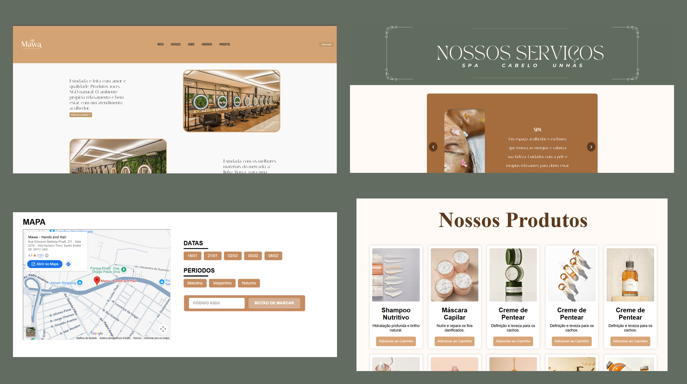

<div align="center">

# 💇‍♀️ Mawa – Hands and Hair

**Site institucional para um salão de beleza, com catálogo de produtos e agendamento de horários.**


<br>



</div>

---

## 📖 Sobre o projeto

O **Mawa – Hands and Hair** é um site desenvolvido como **projeto final do 1º semestre** do curso de **Análise e Desenvolvimento de Sistemas** na Escola Senai Armando de Arruda Pereira (Mauá/SP).

A proposta foi criar a presença digital de um salão de beleza real, apresentando seus serviços, produtos, localização e um fluxo de agendamento. O projeto foi a primeira experiência prática com a construção de uma interface completa e serviu para aplicar, na prática, muitos recursos de **HTML, CSS e JavaScript**.

## ✨ Funcionalidades

- 🏠 **Página inicial** com apresentação do salão, destaque dos diferenciais e navegação por menu
- 💆 **Seção de serviços** (Spa, Cabelo e Unhas) em formato de **carrossel** interativo
- 🛍️ **Catálogo de produtos** em cards, com botão de adicionar ao carrinho
- 📍 **Mapa de localização** integrado (Google Maps)
- 📅 **Área de agendamento** com seleção de datas e períodos (matutino, vespertino e noturno)
- 🎨 **Identidade visual própria**, com paleta de tons terrosos e verde acinzentado inspirada no salão


## 🛠️ Tecnologias utilizadas

- **HTML5**: estrutura semântica das páginas
- **CSS3**: layout, cores, tipografia e identidade visual
- **JavaScript**: interatividade (carrossel, seleção de datas/períodos, carrinho)
- **Google Maps**: incorporação do mapa de localização
- **Git e GitHub**: versionamento e publicação do código

## 🚀 Como executar

Não é necessário instalar nada. Basta:

```bash
# 1. Clone o repositório
git clone https://github.com/oricoMiguel/Mawa.git

# 2. Entre na pasta
cd Mawa

# 3. Abra o index.html no navegador
```

> 💡 Dica: se usar o VS Code, a extensão **Live Server** abre o site com recarregamento automático.

## 📚 O que aprendi

- Estruturar um site com múltiplas seções usando HTML semântico
- Criar layouts com **Flexbox** e **Grid** e cuidar da responsividade
- Aplicar uma identidade visual consistente (cores, fontes e espaçamentos)
- Dar vida à interface com **JavaScript**: eventos, manipulação do DOM e componentes interativos
- Organizar e versionar um projeto com **Git e GitHub**
- Trabalhar em grupo e transformar a necessidade de um cliente real em uma interface

## 🔮 Próximos passos

- [ ] Conectar o agendamento a um back-end com banco de dados
- [ ] Implementar carrinho de compras completo
- [ ] Melhorar a responsividade para dispositivos móveis
- [ ] Publicar o site com GitHub Pages

## 👨‍💻 Autor

**Miguel**
Estudante de Análise e Desenvolvimento de Sistemas – Escola Senai Armando de Arruda Pereira

[](https://github.com/oricoMiguel)
[](https://www.linkedin.com/)

---

<div align="center">
Feito com ☕ e dedicação durante o 1º semestre de ADS
</div>
